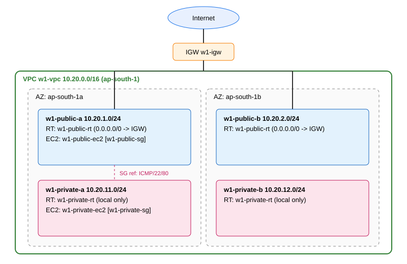
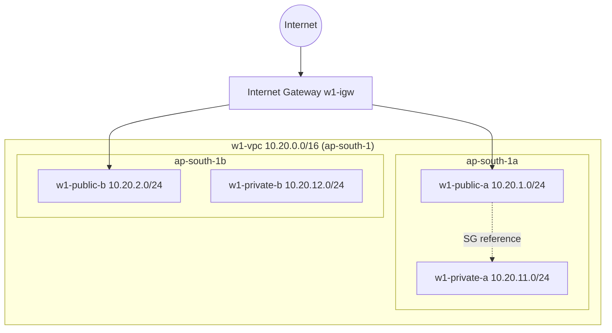

# Week 1: Custom AWS Network (VPC)

**IT-SIMPLERA SOLUTIONS | Cloud Computing AWS**
**Student:** _<your name>_  |  **Submission date:** _<date>_

## 1. Objective
Design and implement a segmented AWS network with two Availability Zones, public and private subnets, controlled routing and least-privilege security groups, and verify it with allowed and intentionally blocked connectivity tests.

## 2. Architecture

**Region choice:** ap-south-1 (Mumbai): low latency from Pakistan, 3 AZs, reasonable pricing.

## 3. Prerequisites
- AWS account with VPC / EC2 / IAM permissions
- AWS Console access (optionally Terraform >= 1.5)
- Instructor approval before creating chargeable resources (NAT Gateway, extra public IPv4)

## 4. Design summary
| Item | Value |
|---|---|
| VPC | w1-vpc `vpc-01f0303486a330ed0`, 10.20.0.0/16 |
| Subnets | 2 public + 2 private across 2 AZs ([docs/cidr-plan.md](docs/cidr-plan.md)) |
| Routing | Public RT -> IGW; Private RT -> local only ([docs/route-tables.md](docs/route-tables.md)) |
| Security | Least-privilege SGs ([docs/security-groups.md](docs/security-groups.md)) |
| Access | Session Manager (no SSH open to the internet) |
| Private outbound | NAT not approved, so private subnets are isolated by design |

## 5. Deployment steps
1. Create VPC `w1-vpc` (10.20.0.0/16); enable DNS resolution and DNS hostnames.
2. Create 4 subnets per the CIDR plan; enable auto-assign public IPv4 on public subnets only.
3. Create and attach Internet Gateway `w1-igw`.
4. Create `w1-public-rt` with `0.0.0.0/0 -> igw`; associate public subnets only.
5. Create `w1-private-rt` (local route only); associate private subnets.
6. Create `w1-public-sg` and `w1-private-sg`.
7. Create IAM role `w1-ssm-role` (AmazonSSMManagedInstanceCore).
8. Launch `w1-public-ec2` in `w1-public-a`; optionally `w1-private-ec2` in `w1-private-a`.
9. Run the tests in [docs/connectivity-tests.md](docs/connectivity-tests.md).

Optional: reproduce the network with Terraform ([terraform/](terraform/)).

## 6. Evidence (screenshots)
Account IDs are masked in all screenshots.

### VPC

### Subnets
| Public A | Public B |
|---|---|
|   | 
 |

| Private A | Private B |
|---|---|
|   | 
 |

### Internet Gateway

### Route tables
Public route table (creation and explicit subnet associations):

Private route table (creation and routes: `10.20.0.0/16 -> local` only):

### Security groups

### IAM role for Session Manager

### EC2 instance and web test

## 7. Test results
Summary below; details in [docs/connectivity-tests.md](docs/connectivity-tests.md).

| # | Test | Result |
|---|---|---|
| 1 | Browser -> public EC2, TCP 80 | Pass |
| 2 | Public EC2 -> internet, TCP 443 | Pass |
| 3-8 | DNS, blocked SSH, private isolation | Pending |

## 8. Troubleshooting scenario
The web page initially did not load although Apache was running (`curl localhost` returned 200 and Apache showed zero requests). `curl https://checkip.amazonaws.com` on the instance returned the public IP, proving the IGW and public route worked for outbound traffic, which narrowed the fault to inbound access. After correcting the inbound path, the page loaded (screenshot 15).

## 9. Cleanup
See [docs/cleanup.md](docs/cleanup.md).

## 10. Security notes
No keys, credentials or account IDs are committed. `.gitignore` blocks `*.pem`, `*.key`, `.env` and Terraform state.
