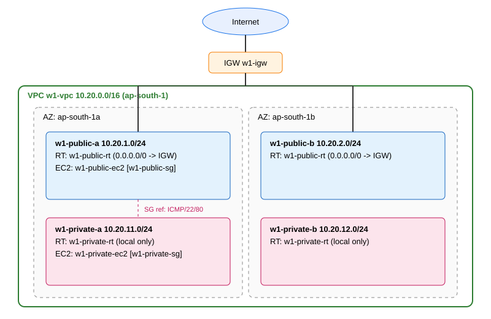
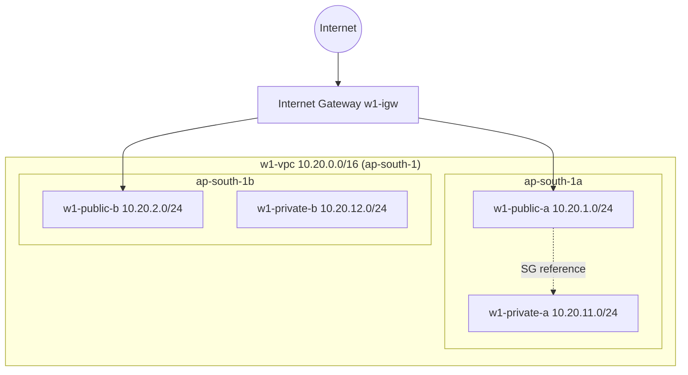

# Week 1: Custom AWS Network (VPC)

**IT-SIMPLERA SOLUTIONS | Cloud Computing AWS**
**Student:** _<your name>_  **Submission date:** _<date>_

## 1. Objective
Design and implement a segmented AWS network with two Availability Zones, public and private subnets, controlled routing and least-privilege security groups, and prove it with allowed and intentionally blocked connectivity tests.

## 2. Architecture

**Region choice:** ap-south-1 (Mumbai): lowest latency to Pakistan among standard regions, 3 AZs, reasonable pricing. _(Edit if you choose another region.)_

## 3. Prerequisites
- AWS account with VPC/EC2/IAM permissions
- AWS Console access (optionally AWS CLI / Terraform >= 1.5)
- Instructor approval before creating chargeable resources (NAT Gateway, extra public IPv4)

## 4. Design summary
| Item | Value |
|---|---|
| VPC | 10.20.0.0/16 |
| Subnets | 2 public + 2 private across 2 AZs (see [docs/cidr-plan.md](docs/cidr-plan.md)) |
| Routing | Public RT -> IGW, Private RT -> local only ([docs/route-tables.md](docs/route-tables.md)) |
| Security | Least-privilege SGs ([docs/security-groups.md](docs/security-groups.md)) |
| Access | Session Manager (no open SSH) / SG-restricted SSH |
| Outbound for private | NAT not approved, so isolated by design (see route-tables.md) |

## 5. Deployment steps (Console)
1. Create VPC `w1-vpc` 10.20.0.0/16, enable DNS resolution + DNS hostnames.
2. Create 4 subnets per the CIDR plan; enable auto-assign public IPv4 on public subnets only.
3. Create and attach Internet Gateway `w1-igw`.
4. Create `w1-public-rt` with `0.0.0.0/0 -> igw`, associate public subnets only.
5. Create `w1-private-rt` (local route only), associate private subnets.
6. Create `w1-public-sg` and `w1-private-sg`.
7. Create IAM role `w1-ssm-role` (AmazonSSMManagedInstanceCore).
8. Launch `w1-public-ec2` (public-a) and, budget permitting, `w1-private-ec2` (private-a).
9. Run tests in [docs/connectivity-tests.md](docs/connectivity-tests.md) and take screenshots into `screenshots/`.

Optional: reproduce everything with Terraform, see [terraform/](terraform/).

## 6. Test results
See [docs/connectivity-tests.md](docs/connectivity-tests.md).

## 7. Troubleshooting scenario
Removed `0.0.0.0/0 -> igw` from `w1-public-rt`: `curl` from the public instance timed out. Re-added the route: access restored. _(Add screenshots.)_

## 8. Cleanup steps
See [docs/cleanup.md](docs/cleanup.md).

## 9. Security notes
No keys, credentials or account IDs are committed. Screenshots have account IDs blurred.
